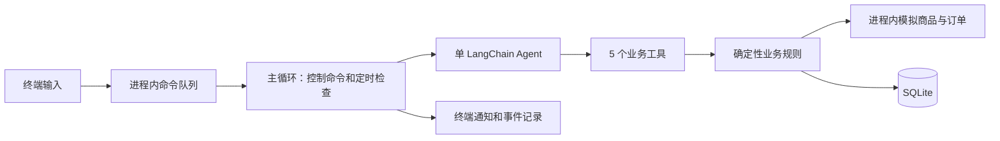

# iPhone 购买跟进 Agent 最小 Demo 实现方案

> 状态：本方案的最小初版已实现；实际范围、测试结果及未验证部分见 `docs/验收记录.md`，本方案中的计划表不作为通过声明。依据：`项目demo需求.md`及本次最小化审查结论。
>
> 目标：在题面约定的半天投入上限内，交付能运行、能重放、有证据的三条业务路径。
>
> 架构：Python CLI + 单 LangChain Agent + 原生人工确认 + SQLite + 进程内定时循环。

## 1. 首版范围

首版只解决“帮测试用户选择并跟进买到适合的 iPhone”。优先把正常、调整、控制三条路径做实，不承诺实现题面的全部分支。

| 必做路径 | 最小演示内容 |
| --- | --- |
| 正常购买 | 澄清需求 → 比较模拟商品 → 用户确认具体订单 → 模拟下单 → 等待用户支付 → 跟进物流 → 核对正确收货 |
| 条件变化与外部异常 | 修改预算使旧建议和确认失效 → 重新比较确认 → 下单已受理但响应超时 → 只查询原订单，不再购买 |
| 用户控制 | 暂停 → 期间有新事实但不主动推进或通知 → 恢复按最新事实继续且不补发 → 结束后迟到事实仅补记 |

三条路径共同展示：没有新聊天也会定时检查；关键变化产生通知；重复事实或无变化不打扰。截止时间限制、下单授权、金额计算、确认失效和完成标准始终生效。

**首版不做：** Web 界面、独立 Worker 进程、多 Agent、分布式调度、任务租约、并发任务执行、跨任务偏好记忆、完整售后系统、真实电商与真实支付。先不增加这些能力对应的表、工具和抽象层。

**可选扩展：** 无合适商品的解释、物流延期的选项提示、完整错误商品处理、退款状态时间线。只在核心路径和交付材料完成后考虑，验收记录逐项标注是否覆盖。

## 2. 最小技术栈与运行结构

| 组件 | 选择及职责 |
| --- | --- |
| Python 3.11+ | CLI、业务规则、模拟服务和调度 |
| LangChain 1.x `create_agent` | 澄清、比较、选择工具与多步执行 |
| `langchain-openai` | 构造支持 tool calling 的模型，模型名称和接入地址可配置 |
| `HumanInTheLoopMiddleware` | 模拟下单前暂停，等待用户批准或拒绝 |
| `langgraph-checkpoint-sqlite` | 保存 Agent 消息和人工中断，直接复用官方能力 |
| 标准库 `sqlite3` | 保存任务、购买操作和事件；预算与订单状态以业务记录为准 |
| 标准库 `threading`、`queue` | 输入线程接收命令，主循环串行处理业务 |
| `python-dotenv`、pytest | 配置读取与关键业务验收 |

不额外引入 Web 框架、ORM、调度框架或消息队列服务。依赖安装与一次真实模型冒烟通过后，再提交准确版本的 `requirements.txt`。



只启动一个进程、运行一个选定任务。输入线程只读取并入队；Agent 调用、业务写入和模拟服务调用均由主线程串行执行，因此不需要跨进程锁或租约。多个用户任务可分别存储，但首版不支持同时执行。

程序必须保持运行才能主动跟进；退出后不承诺后台继续。SQLite 保存业务进展和 Agent 检查点，重启时先读取最新状态与时间，不补跑停机期间的所有轮次。自动恢复崩溃中的执行不作为首版承诺；遇到在途订单先核验，不能重放下单。

## 3. Agent 与业务规则的边界

### 3.1 Agent 负责

- 逐步询问用途、当前手机问题、地区、预算、型号/容量/成色偏好和最晚需要日期。
- 分清硬条件、可协商偏好和待决定事项，明确检查频率、通知方式及跟进截止时间。
- 调用工具查询和比较真实存在于模拟数据中的商品，不输出预写购买结论。
- 在定时或新事实触发时，根据最新任务状态选择查询商品、查询订单或等待用户。
- 解释建议、异常和下一步，发起需要用户批准的模拟下单调用。

### 3.2 Python 负责

金额计算、用户归属、需求版本、确认有效性、状态迁移、下单幂等、通知去重、终态限制和完成判定由代码强制执行。提示词只辅助理解，不替代约束。

暂停、恢复、结束、购买批准以及用户支付/收货反馈通过明确 CLI 命令进入应用。Agent 不能代替用户批准、支付或确认收到正确商品。跨任务偏好不存储、不自动带入；当前任务的偏好更正按需求修改处理。

### 3.3 仅保留 5 个工具

| 工具 | 入参要点 | 作用与边界 |
| --- | --- | --- |
| `update_requirements` | 用户消息编号、需求补丁、预期版本 | 保存用户明确表达的需求及授权；后台触发不能自行修改 |
| `search_iphones` | 当前约束版本 | 返回候选、价格组成、优惠条件、库存、配送和报价版本 |
| `prepare_purchase` | 报价编号、报价版本、约束版本 | 生成固定购买快照和操作编号，不创建外部订单 |
| `place_simulated_order` | 操作编号 | 唯一外部写工具；人工批准后仍校验最新条件 |
| `get_order_status` | 已存在的操作编号 | 查原订单的受理、支付、物流状态；未知结果按原幂等键核验 |

`user_id`、`task_id`、触发来源由应用通过 `context_schema`、`ToolRuntime` 注入，不让模型任意指定。每个工具校验操作归属。

任务快照通过每轮上下文提供，商品查询已经包含报价详情；证据通过 CLI 查看，因此不再单独增加“查任务”“查报价”“查证据”工具。每次模型调用前刷新快照，工具执行后返回最新版本，避免依赖旧聊天。

### 3.4 LangChain 接入方式

使用 `langchain.agents.create_agent`，传入模型、上述工具、系统提示词、运行上下文、`SqliteSaver` 和 `HumanInTheLoopMiddleware`。不使用旧版 `initialize_agent` 或 `AgentExecutor`。

人工确认只拦截 `place_simulated_order`，允许 `approve`、`reject`，显式采用 `interrupt_mode="batched"`，且一个任务同时最多一个待确认下单动作。

处理顺序：

1. Agent 先准备完整购买快照，再调用下单工具；中间件产生人工中断。
2. CLI 从存储快照展示商品、容量、成色、卖家、总费用及配送条件，不仅展示操作编号。
3. 用户输入 `/approve <operation_id>` 或 `/reject <operation_id>`。应用匹配当前用户、任务、中断与操作，记录这一次决定。
4. 批准后，用相同 `thread_id` 调用 `Command(resume={"decisions": [{"type": "approve"}]})`；拒绝对应传入 `reject`。这是唯一一次用户购买确认，无需再增加第二套批准交互。
5. 工具重新检查任务、需求版本、报价、库存、配送、费用和操作状态，全部有效才提交。

原生检查点承载消息和中断；SQLite 业务记录承载确认绑定的快照和版本。条件改变或任务暂停/结束/到期后，旧批准请求被应用拒绝；旧中断通过拒绝决策关闭，不附带放行理由。清理旧中断期间只允许完成拒绝，禁止新增业务推进；随后刷新上下文。无需构建会话代次管理系统。

Agent 调用记录必须能看到真实 tool calls、参数、结果及中断。模型名称、密钥、可选 `base_url`、超时和单轮调用上限通过配置提供；下单工具不配置自动重试。API 细节以实际锁定版本的冒烟验证为准。

## 4. 最小状态与数据

### 4.1 只设 3 类业务记录

| 表 | 保存内容 |
| --- | --- |
| `tasks` | 用户/任务编号、生命周期、业务阶段、需求 JSON 与版本、持续跟进授权、检查频率、下次检查时间、期望收货时间、跟进截止时间、最近通知指纹 |
| `operations` | 固定购买快照、确认版本与有效期、用户批准记录、固定幂等键、提交状态、订单编号、有限核验次数与截止点 |
| `events` | 用户消息和反馈、来源事实、工具调用、状态变化、通知及错误，保存事件编号、时间、来源去重键和负载 |

Agent checkpoint 使用官方 SQLite saver 自行管理，可单独保存为 `checkpoints.sqlite`；不手写 checkpoint 表，不增加独立偏好、通知、审计业务表。

商品和报价来自少量 JSON。模拟订单保存为独立的本地 JSON 文件，按幂等键查询，模拟“远端已受理，本地回执未知”。业务层只能通过模拟服务查询它，不能偷读订单文件直接认定成功。单进程下以原子替换写入文件即可，不实现外部服务部署。

### 4.2 最小状态字段

- 任务生命周期：`ACTIVE / PAUSED / ENDED / EXPIRED / COMPLETED`。
- 业务阶段：`CLARIFYING / SEARCHING / WAITING_CONFIRMATION / ORDER_UNKNOWN / WAITING_PAYMENT / TRACKING / VERIFYING_RECEIPT / NEEDS_DECISION`。
- 操作状态：`PREPARED / SUBMITTING / UNKNOWN / ACCEPTED / REJECTED`。

生命周期独立于订单状态：暂停或结束不会自动取消已受理订单。已结束、已到期、已完成任务不会被新事实自动恢复；只有暂停任务可以恢复。

### 4.3 不可删减的规则

1. **持续跟进需授权：** 必须明确检查频率、跟进截止时间与通知方式；缺关键决定时等待，沉默不算批准。
2. **预算按整数分计算：** 总费用包含运费和必付费用，只扣已核实可享优惠。4999 元附换新条件、普通价 5799 元时，资格未知按 5799 元比较。
3. **确认绑定具体快照：** 商品、卖家、容量、成色、总费用、配送、报价版本及需求版本一致才有效；条件变化立即废止受影响确认。
4. **旧结果不能覆盖新条件：** 需求版本变化后，旧版本结果只作为历史记录；拒绝用它推荐或购买。
5. **每个任务只允许一个未解决购买操作：** 已提交、结果未知或旧订单状态未核实时禁止新购；重新购买需要新确认。
6. **到期与期望收货日分开：** 只由跟进截止时间决定到期。物流延期不能自动结束任务，也不授权取消或重下单。
7. **完成依赖双重证据：** 订单和交付信息一致，且测试用户明确反馈收到正确商品才完成；待支付、支付成功、物流送达均不足以完成。
8. **失败和冲突不等于成功：** 查询失败、数据缺失、矛盾事实标为待核验；重复事件去重，不重复执行或通知。
9. **隔离有效：** 所有读取按用户与任务过滤。首版没有账户系统，不代表可以混用不同任务的数据。

## 5. 定时循环、用户控制与通知

### 5.1 无新聊天时推进

主循环定期检查当前时间和命令队列，处理控制命令、新事实以及到期检查。业务检查间隔以用户约定为准；没有到期工作时不调用模型。

演示时钟随运行时间推进，`/advance <seconds>` 可额外推进同一个时钟；脚本重放可直接使用注入时钟，无需真实等待数天。没有新聊天时，循环仍会触发查询，满足主动跟进要求。

所有业务串行处理。模型请求使用有限超时和调用上限；输入线程在模型运行期间仍可接收命令。每次工具副作用、通知和最终结果写入之前，主线程先检查待处理控制命令、有效需求版本和当前截止时间，避免排队中的暂停或修改被旧回合越过。命令生效点以事件记录为准，不声称可以撤销已受理提交。

### 5.2 控制命令

| 控制 | 最小行为 |
| --- | --- |
| `/pause` | 停止主动搜索、常规订单跟踪和通知；未提交确认失效 |
| `/resume` | 未到期才恢复；读取最新事实作为基线，不补发暂停期间提醒 |
| `/end` | 停止新增推进，记录用户放弃；已有订单保留实际状态 |
| 到达跟进截止时间 | 转为 `EXPIRED`，不再新增搜索或购买；记录期限届满，不能声称买到 |
| 结束/到期后收到事实 | 只补充记录，不恢复任务、不购买、不主动补发通知 |

暂停、结束或到期后的唯一主动例外，是已提交但结果未知的同一笔操作的有限只读核验。

### 5.3 下单未知结果

提交前保存固定操作和幂等键，模拟服务创建订单后可故意超时。本地记为 `UNKNOWN`，后续只按原键查询，不重复调用创建订单。

核验最多 3 次，且不超过首次提交后 30 分钟演示时间，先到者停止。耗尽后显示“结果未知，待人工核验”，不创建新购买操作。查到已受理订单后记录事实；若任务已结束则仍保持终态。一次“查询不到”不作为未受理的证明。

模拟服务创建订单时再次校验报价版本、库存、费用及配送条件；涨价或缺货拒绝原确认，不留下本地复核与实际受理之间的漏洞。

### 5.4 通知

首版通知方式只支持终端输出，并保存为事件。用户须同意此方式；程序不运行时不对外通知。

- 关键变化：首次有合适方案、订单受理或结果未知、需要用户决定、目标完成。
- 静默：相同报价、重复事件、无变化检查、暂停期间事件、终态迟到事实。
- 使用来源事件编号去重，并按实体与业务状态计算通知指纹；查询时间不参与指纹。通知记录保存在 `events`，不另建系统。

## 6. CLI 与三条演示

### 6.1 最小命令

普通文本作为用户消息。仅保留 `/status`、`/approve <operation_id>`、`/reject <operation_id>`、`/pause`、`/resume`、`/end`、`/advance <seconds>`、`/event <type> <json>` 和 `/evidence`。

`/event` 显式标记为“测试用户模拟入口”，用于报价变化、用户支付、物流和收货反馈。支付/取消/退货/退款申请不注册为 Agent 工具；首版未覆盖的事件类型明确拒绝，不伪装已执行。错误商品反馈至少阻止完成，完整售后处理后置。

### 6.2 三个固定 JSON 场景

只实现简单步骤列表：`chat / command / event / advance / assert`，直接调用 CLI 共用的处理入口，不设计通用脚本引擎。数据描述原始输入和断言，不内置购买结论。

| 文件 | 时间线 | 关键断言 |
| --- | --- | --- |
| `normal.json` | 模糊需求、澄清授权、比较含条件优惠、批准、下单、用户支付、物流、正确收货 | 资格未知按普通价；批准前订单数为 0；待支付不完成；无聊天推进；最终证据齐全 |
| `adjustment.json` | 预算 8000 改 6000、旧建议/确认失效、重新比较批准、创建订单后响应超时、定时查回原订单 | 旧确认被拒；最终费用符合新预算；创建订单仅一次；关键变化通知，重复事件静默 |
| `control.json` | 授权搜索、暂停、报价变化、恢复按最新事实继续、提交结果未知、用户结束、迟到回执 | 暂停不推进不通知；恢复不补发；结束不恢复；原订单有限核验，无新增订单 |

延迟旧查询返回的专门调度场景不作为首版演示承诺；先以带旧版本的模拟结果验证相同拒绝规则。截止时间通过一条短规则测试验证，不再额外扩展演示时间线。

每次重放使用独立数据目录，导出输入、演示时间、工具调用、状态变化、通知、订单数量与证据编号。真实模型输出允许措辞不同，验收以行为和状态为准。

## 7. 最小代码组织与实施顺序

```text
order-agent/
├─ 项目demo需求.md
├─ 实现方案.md
├─ README.md
├─ requirements.txt
├─ .env.example
├─ order_demo/
│  ├─ __init__.py
│  ├─ cli.py           # 输入队列、主循环、定时检查与重放入口
│  ├─ agent.py         # 模型配置、create_agent、5 个工具与原生确认
│  ├─ domain.py        # 任务规则、版本、授权、完成判定
│  ├─ storage.py       # 3 类记录、简单 SQLite 事务
│  └─ simulator.py     # JSON 商品、报价及模拟订单
├─ fixtures/
│  ├─ catalog.json
│  └─ scenarios/       # normal.json / adjustment.json / control.json
├─ tests/
│  ├─ test_rules.py
│  └─ test_scenarios.py
└─ docs/
   ├─ 验收记录.md
   ├─ 修改说明.md
   ├─ evidence/
   └─ ai-records/      # 原始协作记录、索引、人工判断与缺失说明
```

按以下顺序实施；每一步完成后才扩大范围，不提前开发可选功能：

1. **业务规则和模拟服务。** 在 `test_rules.py` 先验证缺确认不下单、费用计算、版本失效、下单未知只查原单、终态禁止新购、截止时间及完成证据，再实现 `domain.py`、`storage.py`、`simulator.py`。同一报价重复查询返回同一事实，创建订单按幂等键唯一。
2. **Agent 与 CLI 闭环。** 完成 `agent.py`、`cli.py` 及模型配置，跑通真实工具查询 → 原生中断 → 用户批准 → 模拟下单。把控制命令接入主循环；不增加 Web 层。
3. **定时推进和三条时间线。** 接入进程内 tick、时间推进、事件去重和终端通知，在 `test_scenarios.py` 验证上述三条路径，导出证据。
4. **验收与交付。** 跑关键规则和场景测试，执行真实模型冒烟，填写实际验收结果、启动说明、修改说明和 AI 协作索引。达到投入上限就交付当前成果和缺口。

首版测试聚焦已实现路径上的关键约束，不要求构建完整模型评测、崩溃恢复或并发压力测试。离线测试可以使用脚本化 tool-calling 测试替身，但须单独标记；真实模型至少执行一次完整正常路径与人工中断，不用替身结果冒充真实模型通过。

## 8. 逐项验收口径

下表是计划，不是结果。所有项目当前均为“尚未执行”；最终记录必须包含输入、预期、实际、证据和结论，未覆盖直接写明。

| 原题场景 | 首版计划 |
| --- | --- |
| 1. 需求模糊 | 正常路径覆盖 |
| 2. 报价有条件 | 正常路径覆盖 |
| 3. 预算改变且旧结果晚到 | 调整路径覆盖预算及确认失效；规则测试注入旧版本结果，延迟返回专门演示后置 |
| 4. 无合适商品 | 后置；首版不能因此擅自放宽硬条件 |
| 5. 确认后涨价或缺货 | 下单前版本与库存校验必做；专门演示后置 |
| 6. 下单回执丢失 | 调整路径覆盖 |
| 7. 等待用户支付 | 正常路径覆盖 |
| 8. 物流延期 | 专门处理与演示后置；不能提前完成或自动取消 |
| 9. 错误商品 | 不判完成的规则必做；完整异常整理后置 |
| 10. 退货退款 | 不纳入首版，不提供售后执行工具 |
| 11. 结束与迟到结果 | 控制路径覆盖 |
| 12. 正确收货 | 正常路径覆盖 |

此外验证无新聊天推进、关键变化通知、重复事实静默，以及基本用户/任务归属检查。跨用户并发、复杂乱序冲突、完整崩溃恢复、跨任务记忆等不列为额外 P0。

## 9. 启动与交付约定

以下命令为实现目标，当前尚无对应业务程序：

```powershell
py -3.11 -m venv .venv
.\.venv\Scripts\python.exe -m pip install -r requirements.txt
Copy-Item .env.example .env
# 填写模型配置后，只需启动一个进程：
.\.venv\Scripts\python.exe -m order_demo.cli --user-id demo --task-id t1
# 场景各自使用独立数据目录：
.\.venv\Scripts\python.exe -m order_demo.cli --replay fixtures/scenarios/normal.json --data-dir data/normal
.\.venv\Scripts\python.exe -m pytest -q
```

`.env.example` 包含 `OPENAI_API_KEY`、`MODEL_NAME`、可选 `OPENAI_BASE_URL`、模型超时和单轮调用上限。缺少真实模型配置时明确提示，不静默替换为预写答案。配置、原始数据均不得包含真实密钥或私人信息。

最终必要材料：

- [ ] 完整源码、验证过的依赖版本、配置示例、公开模拟数据。
- [ ] README：干净环境启动、输入需求、无聊天推进、时间/事件注入、查看结果和运行测试。
- [ ] 验收记录：三条路径及 12 项场景的实际覆盖、失败/未实现和证据位置。
- [ ] 修改说明：复用组件、本次改动、状态保存和未知结果处理等简短取舍。
- [ ] 5–10 分钟等价可重放演示；演示不能替代源码与说明。
- [ ] 可导出的完整 AI/Agent 原始会话及工具结果、索引与关键人工判断；无法导出的范围如实说明，不能以总结冒充完整记录。

题面已约定半天投入上限及通过 BOSS 提交 GitHub 链接。具体提交日期时间、模型费用、私有仓库访问安排尚未确认，本方案不自行承诺或对外发送。

## 10. 官方文档依据

- [LangChain Agents（用户指定）](https://docs.langchain.com/oss/python/langchain/agents)：`create_agent` 与工具执行。
- [Tools](https://docs.langchain.com/oss/python/langchain/tools)：运行上下文与工具定义。
- [Human-in-the-loop](https://docs.langchain.com/oss/python/langchain/human-in-the-loop)：人工中断和批准/拒绝恢复。
- [Short-term memory](https://docs.langchain.com/oss/python/langchain/short-term-memory)：消息和中断持久化。

实现时只验证本方案实际使用的 API 和锁定版本，不为兼容多种 Agent 架构增加适配层。
