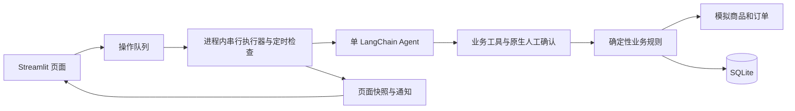

# iPhone 购买跟进 Agent 最小 Demo 实现方案

> 本版按最新要求，将控制台交互替换为简单功能页面。依据《项目demo需求.md》，保留单 Agent、模拟交易、SQLite 和原有验收规则，不增加复杂前端样式。

## 1. 范围

使用 Python + Streamlit + LangChain `create_agent`，完成三条核心路径：

| 路径 | 演示内容 |
| --- | --- |
| 正常购买 | 澄清需求 → 查询比较 → 用户选择 → 原生人工确认 → 模拟下单 → 用户支付 → 物流 → 正确收货核对 |
| 调整与异常 | 预算修改废止旧建议及确认 → 重新比较 → 下单受理但回执超时 → 有限查询原单，不重复购买 |
| 用户控制 | 暂停静默 → 恢复读取最新事实且不补发 → 结束后只补记迟到事实，不重启任务 |

同时保留无合适商品、报价变化、物流延期、错误商品、模拟退款等原始需求验收。支付与售后仅注入模拟事实，不增加执行真实支付或售后的工具。

不做账户认证、真实电商、真实支付、复杂样式、前后端分离工程、多 Agent、多任务并发、独立 Worker 进程、分布式调度和跨任务偏好记忆。

## 2. 最小架构

| 组件 | 职责 |
| --- | --- |
| `app.py`、Streamlit | 唯一用户交互入口，标准组件；消息、状态和通知每秒局部刷新，输入区不定时重绘 |
| `frontend/page.py` | 聊天、需求表单、购买确认、任务控制、模拟反馈与证据展示 |
| `backend/runtime.py` | 单个后台线程串行执行 Agent 和业务操作；页面只投递操作并读取快照 |
| LangChain `create_agent` | 真实模型调用、澄清、工具选择及多步执行 |
| `HumanInTheLoopMiddleware` | 下单工具暂停，用户点击批准或拒绝后恢复 |
| LangGraph SQLite 检查点 | 保存 Agent 消息和人工中断 |
| `domain.py` + `storage.py` | 确定性业务规则及 SQLite 持久化 |
| `simulator.py` | JSON 商品、库存、报价与订单事实 |
| `replay.py` | 非交互式离线场景验收与证据导出 |



不启动独立 API 服务，不引入 Node.js、ORM、外部队列或调度框架。LangChain 工具可能在框架内部线程池运行，现有工具锁保留；页面不会直接访问业务数据库。每个数据目录只运行一个服务进程、一个选定任务。

页面刷新不驱动业务时钟。服务后台循环独立检查，到达约定频率时调用 Agent；关闭页面但服务仍运行时继续跟进。服务退出则停止，重启读取持久状态，不补跑停机期间所有轮次。

## 3. 页面交互

使用 Streamlit 默认布局，不添加自定义复杂样式：

1. **对话**：显示用户与助手消息，发送自然语言请求。模型请求在后台执行。
2. **需求设置**：只必填预算，用途和当前问题可选；地区、型号、容量、成色、收货与跟进日期、检查间隔等放入折叠选项。`config/defaults.json` 默认国行、全新、128GB起、不限型号、7天内收货，跟进7天、600秒一次、页面通知。持续跟进默认关闭，一次明确授权即可开启，不影响未授权时主动查询和购买。预算换算为整数分。表单草稿保留，用户显式载入生效需求才替换草稿；保存携带草稿所基于的版本，旧表单不得覆盖新需求。
3. **商品与订单**：查询候选，展示型号、容量、成色、卖家、总费用、预计送达及附条件优惠说明。明确选择后发起原生 HITL；批准前订单数必须为 0。展示当前订单状态并提供主动查询按钮。
4. **模拟测试**：推进演示时间，注入支付、送达、正确或错误收货、取消、退货退款、报价库存变化、回执超时和来源失败。
5. **通知与记录**：显示关键变化、事实与工具记录，下载 JSON 证据。

页面顶部提供暂停、恢复、结束。下单批准与拒绝按钮只对应当前有效的固定购买快照。缺模型配置时明确提示，不用离线规则替代聊天或购买确认。精确需求表单和模拟事实操作仍可用。

不再提供控制台聊天或斜杠命令；`backend.replay` 仅处理文件中的离线场景指令，不读取交互输入。

## 4. Agent 与业务规则

Agent 负责澄清需求、解释候选与异常、调用真实工具，并在自动检查事件中读取事实。采用用户指定的官方 [Agents 文档](https://docs.langchain.com/oss/python/langchain/agents) 中的 `create_agent`。

工具继续为 `update_requirements`、`search_iphones`、`prepare_purchase`、`place_simulated_order`、`get_order_status`。下单工具由原生人工确认中间件拦截，不由页面直接批准业务后调用下单来替代原生中断。

Python 强制约束：

- 预算明确即可比较；默认条件不得代替预算、跟进授权或具体订单确认。用途与当前手机问题可选，用户提供的条件优先于默认值。
- 持续跟进必须明确授权；期望收货时间与跟进截止时间独立保存，默认相对天数首次应用时固定成日期，重启不顺延。旧任务只补缺失默认项，不覆盖已保存决定或变更需求版本。
- 用户/任务归属、需求版本与报价版本必须匹配。
- 优惠资格未知时使用普通价；价格、运费及费用共同构成最终总额。
- 购买批准绑定固定快照、版本与操作；预算、报价、库存或控制变化后旧确认失效。
- 创建前保存幂等键，下单未知只核验原操作，受次数和时间限制。
- 页面控制与需求变更在后续工具副作用前检查；无法撤销已经受理的外部订单。
- 暂停不主动推进或通知；恢复建立静默基线；结束和到期禁止新购，迟到事实不自动重启。
- 关键事实去重通知，无变化不打扰；冲突事实标为待核验。
- 支付、送达均不等于目标完成；订单一致性证据与用户正确收货反馈一致才完成。

业务状态和 Agent 检查点继续保存到 SQLite。页面聊天另记事件以便重启展示。模型请求错误显示到页面并记录证据，自动检查失败按间隔重试，不持续快速调用。

## 5. 最小代码结构

```text
app.py
frontend/
  __init__.py
  page.py        # 页面、表单和局部刷新
backend/
  __init__.py
  config.py      # 项目根路径和 config/.env 读取
  runtime.py     # 操作队列、后台检查和快照
  replay.py      # 离线验收
  agent.py       # create_agent、工具、原生确认与检查点
  domain.py      # 确定性业务规则
  storage.py     # SQLite
  simulator.py   # 模拟外部事实
config/
  .env.example
  .env           # 本机密钥，忽略
  catalog.json
  defaults.json  # 默认条件，预算与授权不预设
  simulated_external.json
  scenarios/     # normal / adjustment / control
tests/
  test_acceptance.py
  test_agent.py
  test_defaults.py
  test_runtime.py
  test_page.py
  test_replay.py
  test_project_layout.py
  test_live_model.py
data/            # 本机 SQLite 与 Agent 检查点，忽略
```

`config/` 中的配置示例、默认需求 `defaults.json`、两个商品 JSON 和三条场景均纳入 Git。真实 `config/.env`、旧 `fixtures/`、`docs/` 与会话目录 `data/` 忽略，使用普通排除规则。`simulated_external.json` 不再被全局排除。

页面默认从 `config/simulated_external.json` 读写实际模拟状态，数据库仍在 `data/web/`。通过 `DEMO_MOCK_FILE` 可设置其他模拟状态路径；新文件从 `config/catalog.json` 初始化。共享商品使用相对配送时长，进程启动时计算当前报价时间，已有订单快照保留绝对时间。测试与离线重放默认在独立数据目录保存模拟状态，不读写页面共享文件。

前后端按代码模块分离，仍保持单进程启动。`backend/config.py` 基于源码位置定位项目根目录，配置和商品加载不依赖当前工作目录。同一数据库目录或模拟状态文件只允许一个服务进程使用。

## 6. 验收策略

保留 `tests/test_acceptance.py` 对原始需求 1–12 的业务断言，不以页面文案或模型措辞代替状态与副作用验证。正常、调整、控制三条非交互式重放共 34 个断言，导出独立证据。

页面新增验证：需求保存、草稿保留与显式载入、暂停恢复结束按钮、选商品至原生批准再到正确收货的完整按钮流程；运行时验证无聊天定时检查、模型请求期间暂停阻止后续准备、缺模型明确报错及无订单副作用。

Agent 集成使用真实 LangChain 框架及离线 tool-calling 模型替身，在线模型验收独立启用并如实记录。未配置模型时不声称在线测试通过。页面测试采用 Streamlit AppTest，不要求外部浏览器驱动。

## 7. 启动与验证

```powershell
.\.venv\Scripts\python.exe -m pip install -r requirements.txt
# 复制 config/.env.example 为 config/.env，填写模型配置。
.\.venv\Scripts\python.exe -m streamlit run app.py
.\.venv\Scripts\python.exe -X utf8 -m pytest -q
.\.venv\Scripts\python.exe -X utf8 -m backend.replay --scenario config/scenarios/normal.json --data-dir data/new-normal
```

默认页面地址 `http://localhost:8501`。任务、数据库目录和模拟状态分别通过 `DEMO_USER_ID`、`DEMO_TASK_ID`、`DEMO_DATA_DIR`、`DEMO_MOCK_FILE` 配置。全新演示更换任务、数据库目录和模拟 JSON 路径后重启，保留旧证据。详细启动、模拟反馈和可选在线测试见 README。
